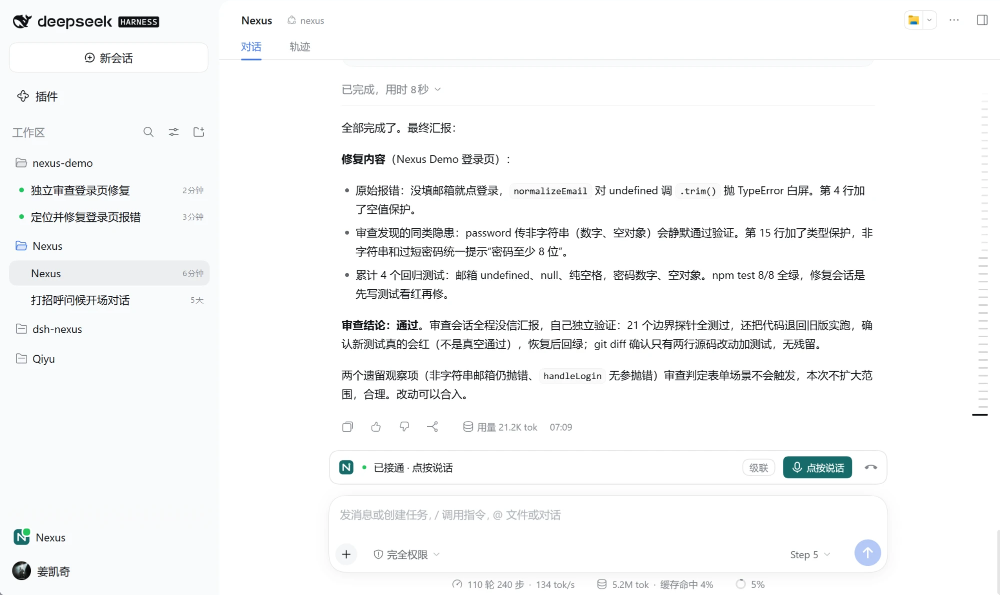
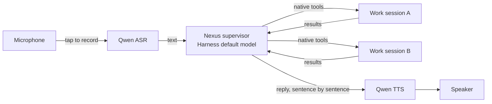
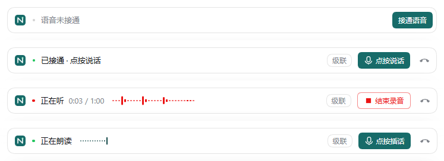
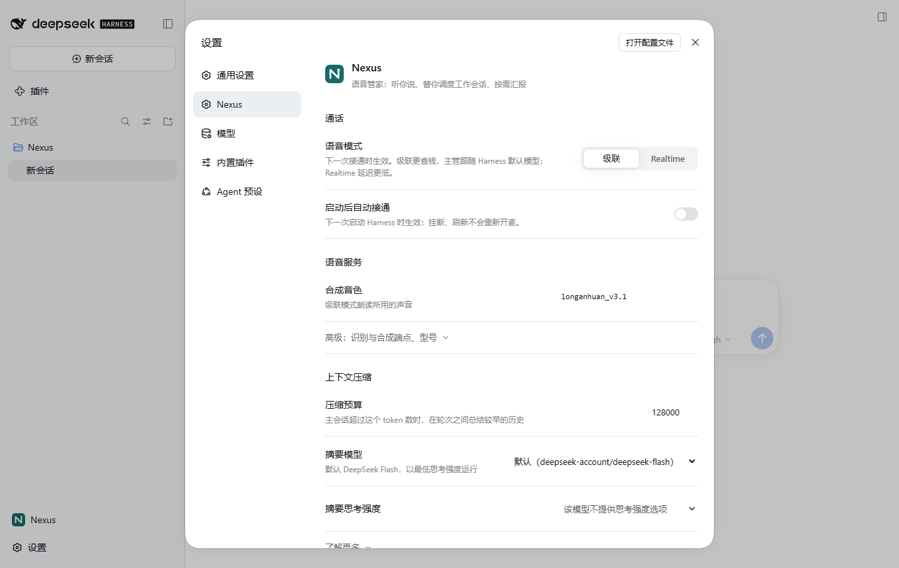

<div align="center">


# Nexus

**Nexus is your voice butler for DeepSeek Harness: you speak, and it understands what you mean, hands the work to the right agents, follows up on the results, and talks back.**

English | [简体中文](README.zh-CN.md)


</div>

Instead of driving each agent yourself, hand the job to Nexus, for example:

> "Open a session in the nexus-demo project and fix that login page error, then open another session to review the fix."

Nexus hands the task to the right agents using Harness's native tools, and answers you by voice. While the work runs you can keep talking to it, change your mind, or type directly into a work session. When you hang up, Nexus and the other agents keep running, and you continue in the same main session by text.

<p align="center">
  <picture>
    <source media="(prefers-color-scheme: dark)" srcset="docs/images/main-session-dark.png">
    
  </picture>
  <br>
  <sub>The Nexus main session: the fix and the review go to the two work sessions on the left, and Nexus reports back with the combined result.</sub>
</p>

## Features

- **Dispatches to real sessions.** Works with the sessions you already have and new ones it creates. Subagents spawned inside a session stay with their parent.
- **Tap to talk.** Tap to start recording, tap again to send. Speech is transcribed by Qwen ASR, and the reply is read aloud sentence by sentence.
- **Interrupt any time.** Starting a new recording stops playback immediately. Work already dispatched keeps going.
- **Keeps working after hang-up.** The same supervisor model continues in text. No voice is generated after you hang up.
- **Uses your Harness default model.** The supervisor follows the model and reasoning effort you picked in Harness. No separate model to manage.
- **Bounded context.** The main session supports `/compact` and automatic compaction, with a 128,000-token budget by default.
- **Reversible cleanup.** "Clean up that session" uses Harness's native archive. Nothing is deleted.
- **Two voice modes.** Cascade (default, cheaper and more reliable at dispatching) or Realtime (end-to-end voice model). Switching takes effect on the next call and keeps the history.

## How it works



In Cascade mode, connecting a call only prepares the microphone and playback. Nothing stays connected to a model; recognition and synthesis are requested only when needed. Results from work sessions are delivered back to the supervisor automatically, and the supervisor decides what to do next and whether to tell you.

## Requirements

- DeepSeek Harness / Desktop **0.2.0-rc.2** (Cordis 4.0.4). Other versions haven't been tested yet.
- Windows. macOS and Linux are untested.
- A default model configured in Harness that supports tool calls.
- A [DashScope](https://dashscope.aliyun.com/) API key, stored in the Host's credential service as `DASHSCOPE_API_KEY`.
- To build from source: Node.js `^22.19.0 || >=24.0.0`.

## Quick start

Download `dsh-nexus-0.2.0.tgz` from [Releases](https://github.com/jiangkaiqi2005/dsh-nexus/releases/latest).

Open Desktop once so it creates its `desktop` profile, then quit it. Install with the CLI that ships inside Desktop (PowerShell; adjust both the CLI and tgz paths to yours):

```powershell
$dsh = 'D:\DeepSeekHarness\resources\runtime\cli\bin\dsh.cmd'
& $dsh --version   # should print 0.2.0-rc.2
& $dsh plugin --profile desktop add .\dsh-nexus-0.2.0.tgz
```

Then:

1. Open Desktop. In Harness's model settings, pick your default model and reasoning effort.
2. Click **Nexus** at the bottom of the sidebar. Type one line first to confirm the model replies.
3. Click **接通语音** (Connect voice) and allow the microphone.
4. Click **点按说话** (Tap to talk), speak, then **结束录音** (End recording). One recording is at most 60 seconds, and the transcript is sent right away. While Nexus is reading aloud, click **点按插话** (Tap to interrupt) to cut in.
5. Click the phone icon to hang up.

<p align="center">
  <picture>
    <source media="(prefers-color-scheme: dark)" srcset="docs/images/call-states-dark.png">
    
  </picture>
  <br>
  <sub>The call bar, top to bottom: not connected, connected, listening, reading aloud.</sub>
</p>

<p align="center">
  <picture>
    <source media="(prefers-color-scheme: dark)" srcset="docs/images/desktop-dark.png">
    
  </picture>
  <br>
  <sub>When you switch to another session, the call collapses into a draggable pill where you can still end the recording or hang up.</sub>
</p>

> The UI is mostly in Chinese for now.

For a clean test profile, the web client, and the full acceptance walkthrough, see the [installation and usage guide](docs/installation-and-use.md) (Chinese).

## Configuration

Settings live under **Settings → Nexus**. Changes take effect immediately unless noted.

<p align="center">
  <picture>
    <source media="(prefers-color-scheme: dark)" srcset="docs/images/settings-dark.png">
    
  </picture>
</p>

| Setting | Default | Notes |
| --- | --- | --- |
| Voice mode | `cascade` | `cascade` or `realtime`. Takes effect on the next call. |
| Speech recognition model | `qwen-audio-3.1-asr-flash` | |
| Speech synthesis model | `qwen-audio-3.1-tts-flash` | |
| Speech voice | `longanhuan_v3.1` | |
| Compaction budget | `128000` tokens | |
| Summary model | `deepseek-account/deepseek-flash` | Needs a DeepSeek account signed in to Harness, or pick another configured model. Lowest reasoning effort by default. |
| Auto voice on launch | off | When on, tries to connect once per Harness launch. Hang-up and refresh don't reopen the mic. |

Both speech services use the Host credential reference `DASHSCOPE_API_KEY`. Only the reference name goes into the config, never the key itself. Realtime mode uses `qwen3.8-omni-flash-realtime`.

## Privacy and cost

- Microphone audio goes to the recognition service, reply text goes to the synthesis service, and supervisor requests go to your Harness default model. Work sessions use the models you configured for them.
- The API key is read by the Host's credential service. The browser client never receives it.
- Cascade mode was added mainly for cost: in Realtime mode almost all of the spend was re-sent context, and the Realtime model never hit the cache.

## Known limitations

- The supervisor sometimes says "dispatched" without actually calling a tool. Check that the work session really received the message.
- If recognition fails, Nexus shows "没听清" (Could not hear you) and doesn't start a turn. If synthesis fails, only that sentence goes silent; the text is kept.
- Automatic compaction is skipped when there isn't enough old history to summarize, so the token meter can sit above the budget for a while.
- Automated checks run against the real web client and Desktop's own CLI with fake audio devices. The full scenario with physical devices, real DashScope, and a real default model has not been fully verified yet.

See [Troubleshooting](docs/installation-and-use.md#故障处理) (Chinese) for error-by-error fixes.

## Development

```powershell
npm ci --ignore-scripts
npm run typecheck
npm run build
npm test
npm pack   # build the package yourself: dsh-nexus-0.2.0.tgz
```

Tests don't call paid models. They use an isolated profile, local controlled endpoints, and headless Edge. With Desktop 0.2.0-rc.2 installed, you can also run the packaged-install and full-scenario checks:

```powershell
$env:NEXUS_DESKTOP_SMOKE = '1'
node --test --test-concurrency=1 tests/desktop.test.mjs tests/clean-install.test.mjs tests/cascade-install.test.mjs
Remove-Item Env:NEXUS_DESKTOP_SMOKE
```

Project layout:

```
src/        Host side: supervisor, voice, recognition, speech, compaction, work sessions
client.js   Web client UI (sidebar entry, call controls, settings)
locale/     UI strings (en, zh)
tests/      node:test suites and browser probes
docs/       specs, ADRs, research, verification records
```

## Documentation

All documents are in Chinese.

- [Installation and usage guide](docs/installation-and-use.md)
- [Design and full scenario](docs/design.md)
- [Cascade voice spec](docs/cascade-voice/spec.md) · [First version spec](docs/nexus-v1/spec.md)
- [Glossary](CONTEXT.md) · [Architecture decisions](docs/adr/)
