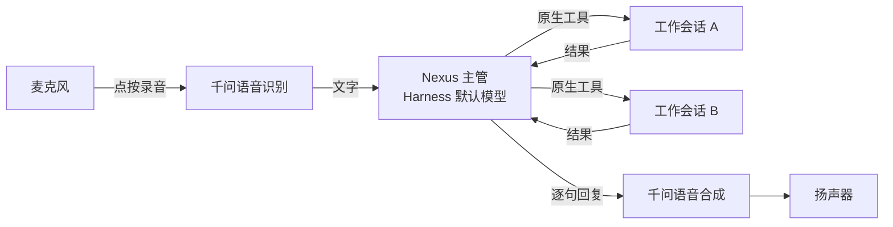

<div align="center">


# Nexus

**Nexus 是你在 DeepSeek Harness 里的语音管家：你只管说，它负责理解意图、分派给合适的 agent、跟进结果，并用语音与你对话。**

[English](README.md) | 简体中文


</div>

不必逐个操作 agent，把要做的事交给 Nexus 就行，比如：

> “在 nexus-demo 项目里开个会话，把登录页那个报错修掉，修完再开一个会话审查。”

Nexus 会用 Harness 的原生工具把任务交给对应的 agent，再用语音回答你。执行期间可以继续和它说话、改要求，也可以直接在工作会话里输入，Nexus 会知道你的直接要求。挂断以后，Nexus 和其他 agent 都继续运行，在同一个主会话里用文字交流。

<p align="center">
  <picture>
    <source media="(prefers-color-scheme: dark)" srcset="docs/images/main-session-dark.png">
    
  </picture>
  <br>
  <sub>Nexus 主会话：修复和审查分别交给左边两个工作会话，Nexus 汇总结果后向你汇报。</sub>
</p>

## 功能

- **派活到真实会话。** 可以用已有的会话，也可以新建。会话里 agent 自己产生的 subagent 由它的 parent 管理，Nexus 不直接插手。
- **点按说话。** 点一次开始录音，再点一次发送。千问负责识别，回复一边生成一边逐句朗读。
- **随时打断。** 朗读时开始录音，声音立刻停下，已经派出的工作继续。
- **挂断后继续。** 同一个主管模型继续处理文字和工作结果，不再合成语音。
- **跟随 Harness 默认模型。** 主管用的就是你在 Harness 里选的默认模型和思考强度，不用另外配。
- **上下文有上限。** 主会话支持 `/compact` 和自动压缩，预算默认 128000 token。
- **清理可撤销。** 说“清理那个会话”时用 Harness 原生归档，不删除数据。
- **两种语音模式。** 级联（默认，更省钱，派活也更准）和 Realtime（端到端语音模型）。切换在下一次接通时生效，历史保留。

## 工作方式



级联模式下，接通只是准备好麦克风和播放，不会一直连着模型，识别和合成在需要时才请求。工作会话的结果会自动交回主管，接下来做什么、要不要告诉你，由主管根据上下文判断。

## 环境要求

- DeepSeek Harness / Desktop **0.2.1-rc.3**（Cordis 4.0.5），本次适配基线。兼容区间仍从 0.2.1-rc.2 起；该版本已在上一版验证，其余 0.2.x 尚未测试。不支持 0.2.0-rc.2。
- Windows。macOS 和 Linux 没有测过。
- 在 Harness 里配好一个支持工具调用的默认模型。
- [DashScope](https://dashscope.aliyun.com/) API Key，在 Host 的凭据服务里以 `DASHSCOPE_API_KEY` 保存。
- 从源码构建需要 Node.js `^22.19.0 || >=24.0.0`。

## 快速开始

安装包为 `dsh-nexus-0.2.2.tgz`，已发布版本见 [Releases](https://github.com/jiangkaiqi2005/dsh-nexus/releases/latest)，也可以按下方开发步骤自行打包。

先正常打开一次 Desktop，让它建立 `desktop` profile，再退出。然后用 Desktop 自带的 CLI 安装（PowerShell，CLI 和 tgz 的路径都改成你自己的）：

```powershell
$dsh = 'D:\DeepSeekHarness\resources\runtime\cli\bin\dsh.cmd'
& $dsh --version   # 本次验证版本为 0.2.1-rc.3
& $dsh plugin --profile desktop add .\dsh-nexus-0.2.2.tgz
```

装好以后：

1. 打开 Desktop，在 Harness 的模型设置里选好默认模型和思考强度。
2. 点侧栏底部的 **Nexus**，先输入一句文字，确认模型能回复。
3. 点 **接通语音**，按提示允许麦克风。
4. 点 **点按说话**，说完点 **结束录音**。一次最多 60 秒，识别出的文字直接发送。Nexus 朗读时点 **点按插话**，可以直接打断它。
5. 用完点电话图标挂断。

<p align="center">
  <picture>
    <source media="(prefers-color-scheme: dark)" srcset="docs/images/call-states-dark.png">
    
  </picture>
  <br>
  <sub>通话条从上到下依次是：未接通、已接通、正在听、正在朗读。</sub>
</p>

<p align="center">
  <picture>
    <source media="(prefers-color-scheme: dark)" srcset="docs/images/desktop-dark.png">
    
  </picture>
  <br>
  <sub>切到别的会话时，通话缩成一个可以拖动的小胶囊，在这里也能结束录音或挂断。</sub>
</p>

干净 profile、Web 客户端和完整的验收步骤见[安装与使用指南](docs/installation-and-use.md)。

## 设置

在 **设置 → Nexus** 里修改，除特别说明外立即生效。

<p align="center">
  <picture>
    <source media="(prefers-color-scheme: dark)" srcset="docs/images/settings-dark.png">
    
  </picture>
</p>

| 设置 | 默认值 | 说明 |
| --- | --- | --- |
| 语音模式 | `cascade` | `cascade`（级联）或 `realtime`，下一次接通生效。 |
| 语音识别型号 | `qwen-audio-3.1-asr-flash` | |
| 语音合成型号 | `qwen-audio-3.1-tts-flash` | |
| 语音合成音色 | `longanhuan_v3.1` | |
| 压缩预算 | `128000` token | |
| 摘要模型 | `deepseek-account/deepseek-flash` | 需要在 Harness 登录 DeepSeek 账号，也可以另选已配置的模型。默认用最低思考强度。 |
| 启动后自动接通语音 | 关闭 | 开启后每次启动 Harness 只尝试一次，挂断、刷新不会重新开麦。 |

识别和合成共用 Host 的凭据引用 `DASHSCOPE_API_KEY`，配置里只写引用名，不要写 key 本身。Realtime 模式使用 `qwen3.8-omni-flash-realtime`。

## 隐私与花费

- 麦克风音频发给识别服务，回复文字发给合成服务，主管请求发给 Harness 默认模型。工作会话用你给它们配的模型。
- 密钥由 Host 的凭据服务读取，浏览器端拿不到明文。
- 加级联模式主要是为了省钱。之前 Realtime 模式的账单里绝大部分是反复重发的上下文，而且 Realtime 模型一直没有命中缓存。

## 已知限制

- 主管偶尔会说“已派活”但实际没调用工具，要以工作会话实际收到的消息为准。
- 识别失败时显示“没听清”，不会发起对话；合成失败只有那一句没声音，文字还在。
- 可压缩的旧历史不够时会跳过自动压缩，所以 token 用量可能暂时高于预算。
- 自动测试用的是真实 Web 客户端和 Desktop 自带 CLI，但音频是假设备。物理设备、真实 DashScope 和真实默认模型的完整场景还没有全部验证。

具体报错怎么处理见[故障处理](docs/installation-and-use.md#故障处理)。

## 开发

```powershell
npm ci --ignore-scripts
npm run typecheck
npm run build
npm test
npm pack   # 自己打包，生成 dsh-nexus-0.2.2.tgz
```

测试不调用付费模型，用的是独立 profile、本地受控端点和无头 Edge。本机装了 Desktop 0.2.1-rc.3 的话，还可以跑打包安装和完整场景检查：

```powershell
$env:NEXUS_DESKTOP_SMOKE = '1'
node --test --test-concurrency=1 tests/desktop.test.mjs tests/clean-install.test.mjs tests/cascade-install.test.mjs
Remove-Item Env:NEXUS_DESKTOP_SMOKE
```

目录结构：

```
src/        Host 端：主管、语音、识别、合成、上下文压缩、工作会话
client.js   Web 客户端界面（侧栏入口、通话控件、设置）
locale/     界面文字（en、zh）
tests/      node:test 测试和浏览器探针
docs/       Spec、ADR、调研和验证记录
```

## 文档

- [安装与使用指南](docs/installation-and-use.md)
- [设计与完整场景](docs/design.md)
- [级联语音 Spec](docs/cascade-voice/spec.md) · [首版 Spec](docs/nexus-v1/spec.md)
- [领域词汇](CONTEXT.md) · [架构决定](docs/adr/)
