# 01：通话横条、顶部胶囊与侧栏入口验证

实施基点：`14a515b`；原型蓝本：`506ba38` 的方案 A。实施与自验由本票实施代理完成，独立 code-review 由协调者安排。本记录不代表用户实机验收通过。

## 实施范围

- 从原型移植 `describe`、`Status`、`Bars`、按钮、模式标签、两个 SVG、`BarA`、`PillA` 和 `SidebarEntry`；复用 primitives，保留 DOM 顺序、`nx-` 类名、图标、原型中文文案和主题参数。英文通过现有 locale 注册。
- 用真实 `Call` 状态、动作和录音开始时间替换假数据；麦克风及播放各分接一个只读 `AnalyserNode`，70ms 采样显示电平。采集、播放、冲刷、回报与帧校验保留。
- 临时提示只在表现层计时，4 秒后显示空闲，新活动立即替换；不篡改 `data-activity`。持久错误显示重试和原始码 Tooltip。重试等待旧 Call stream 结束，避免抢占尚未释放的媒体所有权。
- 侧栏沿用原型图标与状态点；主会话横条、其他页面胶囊共用映射。保留全部六个 `data-*` 属性。
- 未修改 `src/`、协议、状态码、设置表单及其保存语义。

## 受控环境与截图方法

`tests/ui-polish.test.mjs` 启动隔离的官方 Harness Host，复用 `cascade-probe.js` 的受控 LLM，在本机提供 HTTP ASR / WebSocket TTS。浏览器使用 Playwright 的 Edge 与假媒体设备，真实执行 Nexus 客户端、Host 及上下行链；没有直接设置 Call、替换 UI 或编辑截图内容。原始运行日志及失败现场保存在 `.scratch/ui-polish/`，既有语音测试沿用 `.scratch/cascade-voice/`、`.scratch/nexus-v1/`。

视口 `1360×860`，`locale: zh-CN`，`deviceScaleFactor: 1`，两种 `colorScheme`。横条按原型 `shots.mjs` 裁剪：取最后一个 `[contenteditable=true]` 的 bounding box，`{ x: 200, y: max(0, box.y - 190), width: 1160, height: 330 }`；胶囊保存整个视口。

场景驱动：

| 场景 | 真实操作 / 外部条件 |
| --- | --- |
| off | 打开 Nexus，保持未接通 |
| ready | 接通假媒体设备，等待 Host 的 cascade live |
| recording | 点击「点按说话」，等待真实录音计时超过 3 秒 |
| thinking | 输入 `HOLD-SPEECH`，受控 LLM 在首句前等待文件闸门 |
| reading | 释放首句闸门，由 TTS 发送 24kHz 正弦 PCM，等待实际播放电平 |
| unheard | 结束录音，由 ASR 返回空文本 |
| mic-denied | 在浏览器媒体 API 边界拒绝 `getUserMedia`，返回 `NotAllowedError` |
| pill-recording | 在录音中打开另一个普通会话；点击胶囊返回主会话 |

另外断言：横条始终高 44px，与真实输入卡片对齐；暂停实际采集 Context 后波形回到底线；朗读条读到实际播放电平；只替换浏览器墙钟检验剩 10 秒的颜色，不快进 Host 的 60 秒录音限制。60 秒自动结束由既有 tap / barge 测试按真实墙钟验证。

## 基线与实现并排

| 场景 | 基线 `506ba38` | 真实实现 |
| --- | --- | --- |
| dark / off | 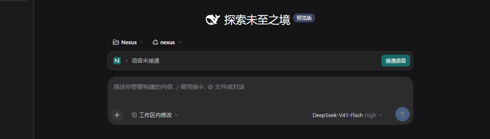 |  |
| dark / ready |  |  |
| dark / recording | 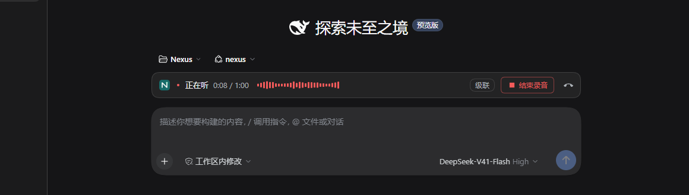 | 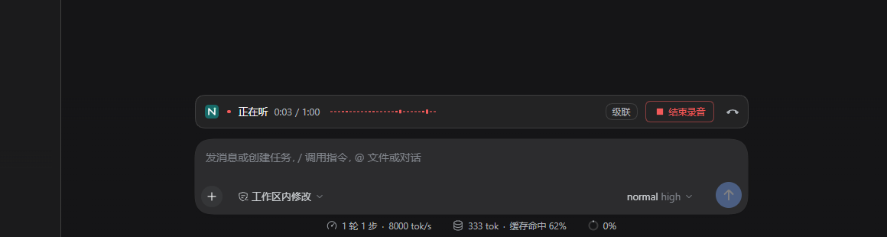 |
| dark / thinking | 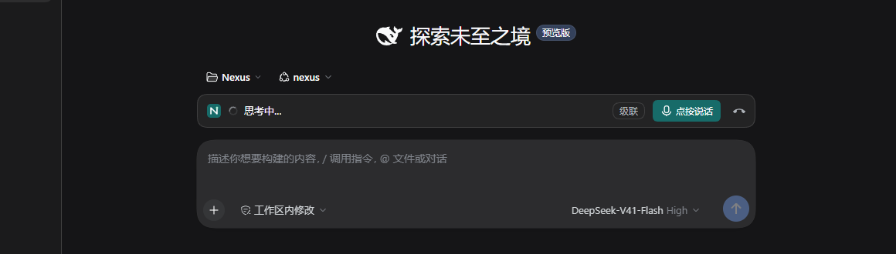 | 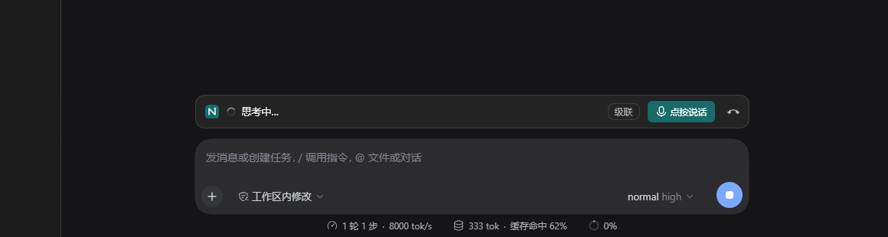 |
| dark / reading | 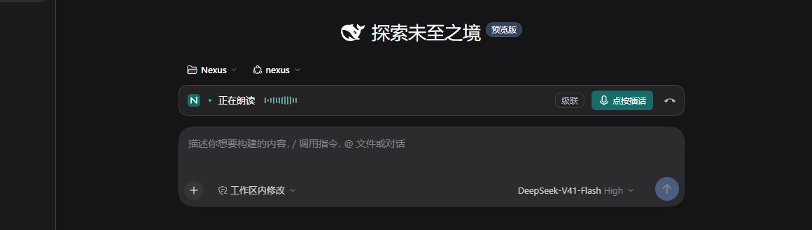 | 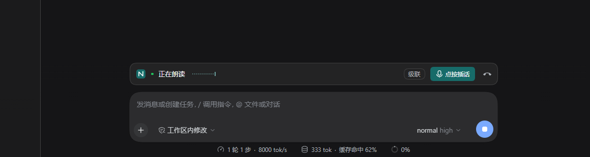 |
| dark / unheard | 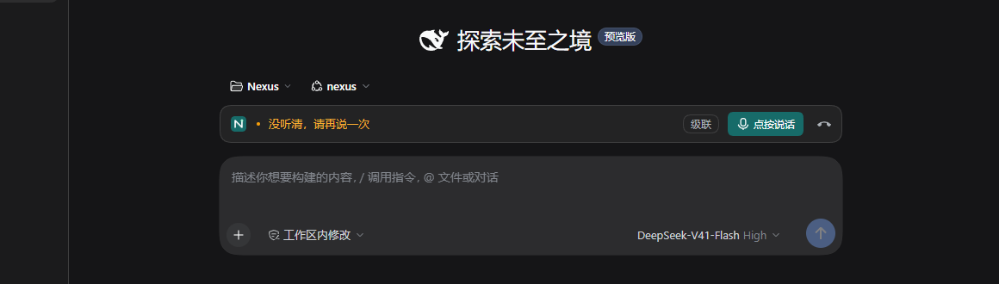 | 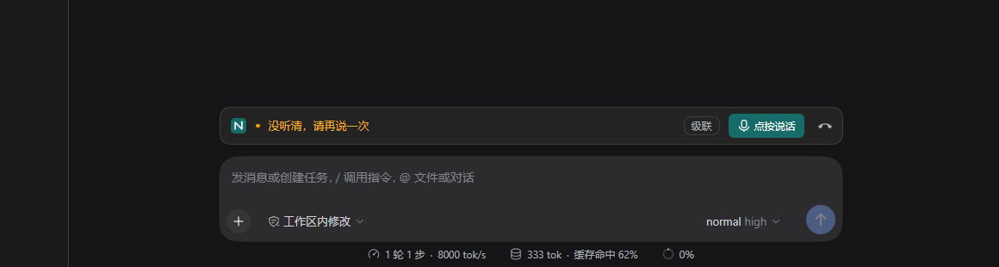 |
| dark / mic-denied |  | 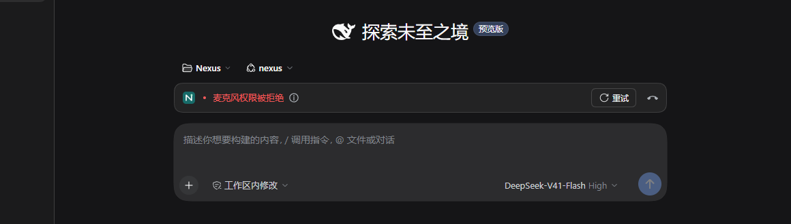 |
| dark / pill-recording |  |  |
| light / off | 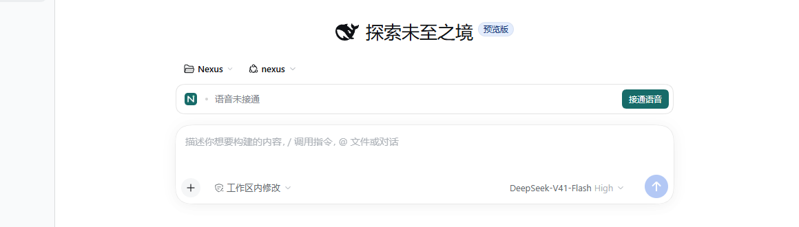 |  |
| light / ready |  |  |
| light / recording | 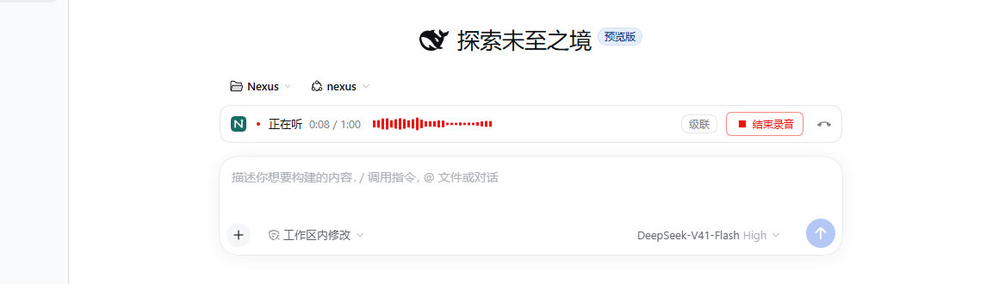 | 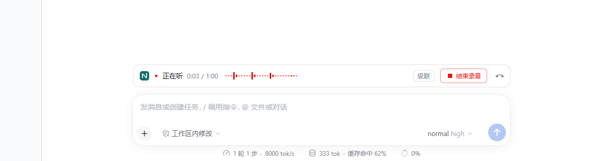 |
| light / thinking | 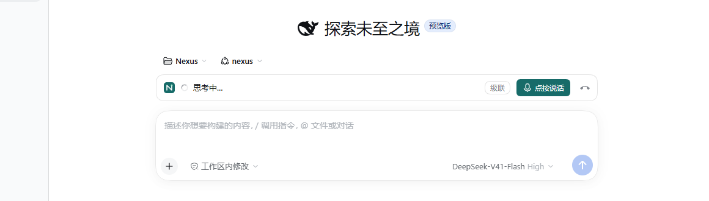 | 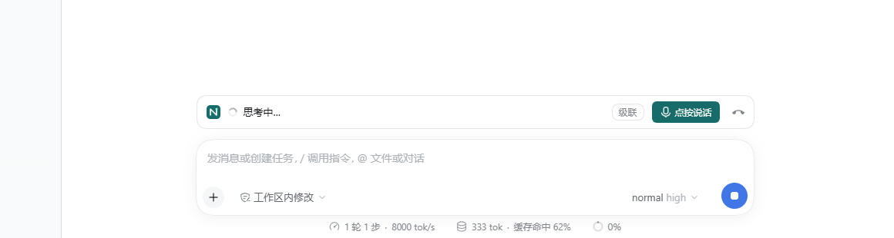 |
| light / reading | 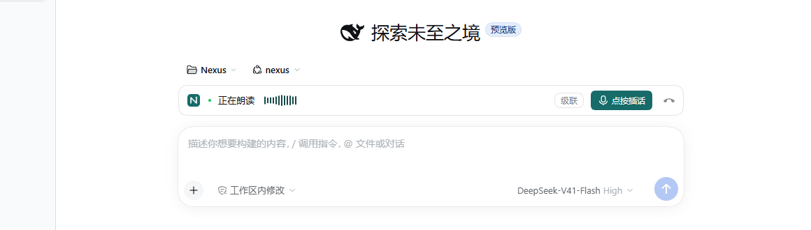 | 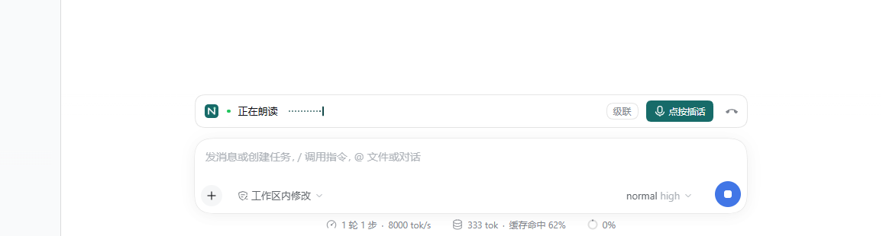 |
| light / unheard | 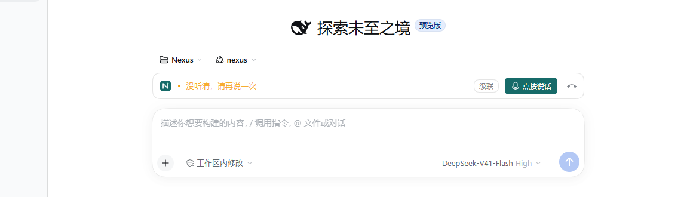 | 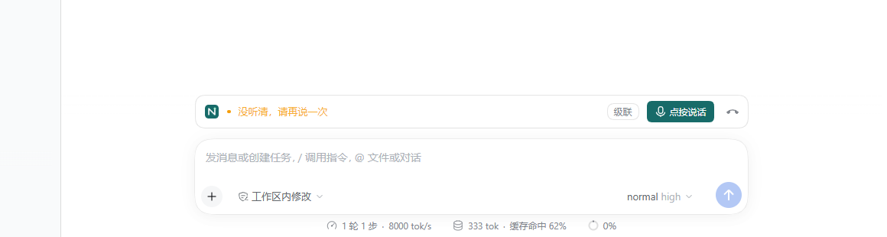 |
| light / mic-denied | 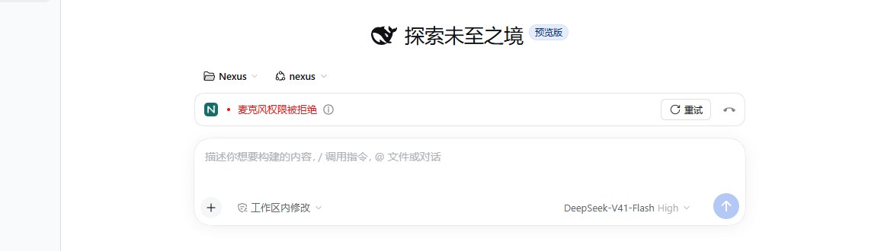 |  |
| light / pill-recording |  |  |

## 偏离清单

1. **真实数据：计时、麦克风波形、播放条和动画帧。** 原型使用随机电平、虚构录音起点；实现读取实际分析节点和录音起点，所以计时数字、波形高度与流光 / 脉冲所在帧不同。对照上述 recording、reading、thinking、pill-recording 图。
2. **真实数据：已发生消息后的宿主界面。** 原型七种横条状态全部停留在空会话；真实 thinking / reading 必须由模型请求和回复驱动。实现图因此出现已用模型 `normal high`、上下文 / 轮次统计、发送 / 停止状态、不同的输入占位文字；标题区也从空会话的 Hero 变为真实消息区域。非空会话输入区位于视口底部，原样沿用 `shots.mjs` 的 clip 后超出视口的部分由 Playwright 裁掉，相关 PNG 高 310px（请求 clip 仍为 330px）；没有移动 UI 或补画截图。其他会话图具有真实会话树和已选择的 Nexus 工作区，原型胶囊图没有已选择的工作区。对照 recording、thinking、reading、unheard、pill-recording 图。
3. **修复原型缺陷：非空会话横条过宽。** 原型 `.nx-a-bar` 在空会话的窄容器中正好对齐，但真实消息出现后 dock 是整列宽度。保留原 CSS，追加 `width: calc(100% - 32px); max-width: 724px; margin-inline: auto`，使本票基线视口下空 / 非空会话都与原生输入卡片对齐。无新增颜色 token；1360×860 下仍是基线的 724px 宽、44px 高。对照 recording、thinking、reading、unheard 图；每次截图均检查横条与实际卡片的 x / width，容差小于 1px。
4. **修复原型缺陷：设置遮罩后仍挂载横条。** 原型仅统计主会话是否挂载，打开设置后既隐藏胶囊，又把横条留在遮罩后。增加不可见的 `settings.action` 生命周期锚点，同一胶囊通过 portal 放入视口大小的设置遮罩层，保持 `PillA` DOM / CSS 不变。点击主区域调用原生 `closeTopModal` 后返回 Nexus，不改设置表单。补充证据：[设置中的胶囊](shots/dark-pill-settings.png)，以及导航测试的单控件和点击返回断言。
5. **修复原型缺陷：跨槽位显示交接。** 原型用普通 effect 计数，初次挂载可能短暂出现横条与胶囊；改为 layout effect 和同步快照订阅，在交接完成后挂载对应控件。MutationObserver 覆盖打开、离开、返回和设置切换，检查任何一批 DOM 变动后均不超过一个 `[data-nexus-voice]`；保留现有实际状态及音频记账属性。
6. **真实数据及原型缺口：失败码和真实动作。** 原型只有模拟的 `NotAllowedError` / `CALL_CLOSED`；实现增加 Spec 的完整失败映射与中英文文案。原始码放在 Tooltip，未知码无提示时直接显示码，避免空提示分隔符；临时 ASR / TTS 提示沿用原型无 info 图标的结构，准确码由语音测试在真实 gateway 下行验证。重试调用真实挂断与接通，并等待旧 stream 释放；这些都替换原型的假状态 / 假动作。同步订阅还会观察到 Host 停止后的实际清理状态：`failed:UNAVAILABLE → idle`；旧测试若最后观察到 idle，现在必须断言紧邻的前一状态确实为该失败，原有真实失败帧和麦克风释放断言不变。对照 mic-denied 图及失败 / 重试测试。
7. **原型专用元素按 Spec 移除。** 胶囊全屏基线底部有粉色 `Switcher`，实现不移植；也没有 B / C、假 store、随机电平、`localStorage` 原型状态。对照两张 pill-recording 图。

## 实际命令与结果

最终完整检查：148 项，136 通过、0 失败、12 跳过，退出码 0；跳过的是需要显式启用真实服务的测试，Desktop 与独立安装均已实际执行通过。以下保留实施中实际执行的聚焦验证，不把失败写成通过。

| 命令 | 实际结果 |
| --- | --- |
| `node --check client.js` | 通过，退出码 0 |
| `npm run typecheck` | 通过，退出码 0 |
| `npm run build` | 通过，退出码 0 |
| `node --test tests/ui-polish.test.mjs` | 首次 0 通过 / 1 失败：夹具缺少必填 endpoint；修正后 0 / 1，旧 UI 没有 `.nx-a-bar`；移植后 1 / 0。随后扩充失败 / 临时提示测试，3 / 0 |
| `node --test --test-name-pattern='dark real' tests/ui-polish.test.mjs` | 1 通过 / 0 失败 |
| `$env:NEXUS_UI_SHOTS='1'; node --test tests/ui-polish.test.mjs` | 首轮 5 通过 / 0 失败并生成 16 图；加入凭据案例后的中间轮 5 / 1，后续由聚焦验证修正 |
| `node --test --test-name-pattern='call bar stays' tests/ui-polish.test.mjs` | 设置场景加入时 0 / 1，修复设置遮罩后 1 / 0 |
| `node --test --test-name-pattern='missing speech credential' tests/ui-polish.test.mjs` | 0 通过 / 1 失败，重复确认 ASR 不带原始原因；没有伪造此场景 |
| `node --test --test-name-pattern='missing synthesis credential' tests/ui-polish.test.mjs` | 首次 0 / 1，真实重试收到 `CALL_BUSY`；等待旧 stream 释放后 1 / 0 |
| `node --test tests/cascade-spoken.test.mjs` | 4 通过 / 0 失败 / 1 跳过（真实 DashScope opt-in） |
| `node --test tests/cascade-lifecycle.test.mjs` | 6 通过 / 0 失败 |
| `node --test tests/cascade-tap.test.mjs` | 5 通过 / 1 失败 / 1 跳过：实施期间 60 秒案例未观察到 HTTP 请求；其余通过 |
| `node --test --test-name-pattern='Host finishes recording' tests/cascade-tap.test.mjs` | 1 通过 / 0 失败，真实墙钟 60 秒上限保留 |
| `node --test tests/startup.test.mjs` | 4 通过 / 1 失败：一次 permission 修复时控件消失；其他启动、设备、播放和模型恢复通过 |
| `node --test --test-name-pattern='permission failure' tests/startup.test.mjs` | 1 通过 / 0 失败；增加修复失败现场记录 |
| `node --test tests/cascade-barge.test.mjs` | 8 通过 / 1 失败：实施期间一次多个回复排队后控件消失，其他插话 / 缓冲 / 60 秒案例通过 |
| `node --test --test-name-pattern='one tap over several' tests/cascade-barge.test.mjs` | 1 通过 / 0 失败；增加客户端错误现场记录 |
| `node --test --test-name-pattern='voice call states\|voice call races\|hangup during a native tool\|committed speech records unavailable words after an unanswered' tests/voice.test.mjs` | 4 通过 / 0 失败 |
| `node --test --test-name-pattern='voice hang-up keeps' tests/voice.test.mjs` | 1 通过 / 0 失败：适配同步订阅实际可见的 `failed:UNAVAILABLE → idle` 清理序列 |
| `node .scratch/ui-polish/audit.mjs` | 最终通过：排除分析节点新增后 Call 与基点相同；帧校验、Settings 与基点相同；排除列明的对齐修复后通用 / A / sidebar CSS 及 SVG 与原型相同。脚本初次因 CRLF/LF 不同失败，第二次误把 `SettingsCallSurface` 当成 `Settings` 起点失败；统一换行并精确匹配函数名后通过 |
| `git diff --check`、`git diff --cached --check` | 均通过，无空白错误 |
| `$env:NEXUS_DESKTOP_SMOKE='1'; $env:NEXUS_UI_SHOTS='1'; npm test`（首轮完整） | 148 项：135 通过 / 1 失败 / 12 跳过，退出码 1。唯一失败为 Host 停止后旧观察断言未接受实际 `failed:UNAVAILABLE → idle`；已在上列聚焦命令中验证调整。原始日志 `.scratch/ui-polish/full-test.log` |
| `$env:NEXUS_DESKTOP_SMOKE='1'; $env:NEXUS_UI_SHOTS='1'; npm test`（最终完整） | 148 项：136 通过 / 0 失败 / 12 跳过，退出码 0，耗时 1228.756 秒。原始日志 `.scratch/ui-polish/full-test-final.log`；包含新增 UI 测试 6 / 0，且三个 Desktop / 独立安装场景全部通过 |

首轮完整检查的三个 Desktop / 独立安装场景均通过，使用 `D:/DeepSeekHarness/resources/runtime/cli/bin/dsh.cmd`：级联安装证据 `.scratch/cascade-voice/06-installed-xF8ggC`，干净 Realtime 场景 `.scratch/nexus-v1/ticket11-scenario-MiJzJS`，Desktop 激活与恢复 `.scratch/nexus-v1/desktop-smoke-ywjWMR`。最终完整轮日志另存 `.scratch/ui-polish/full-test-final.log`。

最终轮重新生成了 16 张要求的双主题场景图及 1 张设置胶囊补充图；均已查看并按上述清单说明差异。两轮级联安装包 SHA256 均为 `99fa619da76193dc20e9bd51f9729a58e236cb3071735911409cd14ce7274453`，期间客户端打包字节不变；最终轮只调整了旧 UI 观察断言，没有修改生产实现。

最终轮安装证据目录：`.scratch/cascade-voice/06-installed-HIgi9z`、`.scratch/nexus-v1/ticket11-scenario-YexpdN`、`.scratch/nexus-v1/desktop-smoke-sQB1Tg`。双主题测量与运行现场分别在 `.scratch/ui-polish/01-1792087484832`、`.scratch/ui-polish/01-1792087499084`；设置胶囊现场在 `.scratch/ui-polish/01-1792087479024`。

## 边界与待验

- **ASR 缺凭据仍无法在真实 UI 中区别于其他 unheard。** `src/recognition.ts` 的 `Recording.finish()` 在 `.catch()` 中丢弃原因，活动回调只报告 phase；`src/supervisor.ts` 传给客户端的该帧没有 code。受控无凭据运行确认下行为 `activity/unheard` 且无 code。前端已支持收到 `ASR_CREDENTIAL_MISSING` 时的专用映射，但现有 Host 不会发它；没有修改 Host、状态码或协议，也没有用“没听清”伪称已完成凭据区分。TTS 缺凭据通过真实 `TTS_CREDENTIAL_MISSING` 验证，包括 4 秒后仍保留、后续活动不覆盖、Tooltip 和重试。
- 8 个要求截图场景在两种主题均实际驱动成功；没有用假 Call 状态替代截图。
- 实施期间曾在聚焦测试运行时继续编辑客户端，官方开发 Host 会热重载客户端；出现过控件被卸载的中间失败。保留上表失败事实；最终整套检查在固定客户端文件上串行运行，不以单次重跑代替最终回归。
- 未调用真实 DashScope 服务；相关 opt-in 测试按默认条件跳过。假媒体不代表真实麦克风、扬声器或设备权限体验的实机验收。
- 横条非空对齐修复按当前原生默认输入宽度和本票视口验证；用户另行调整宿主聊天宽度后的布局未专门验收。
- 用户实机目视验收及协调者独立 code-review 待进行；票 02 设置页分组未实施。
