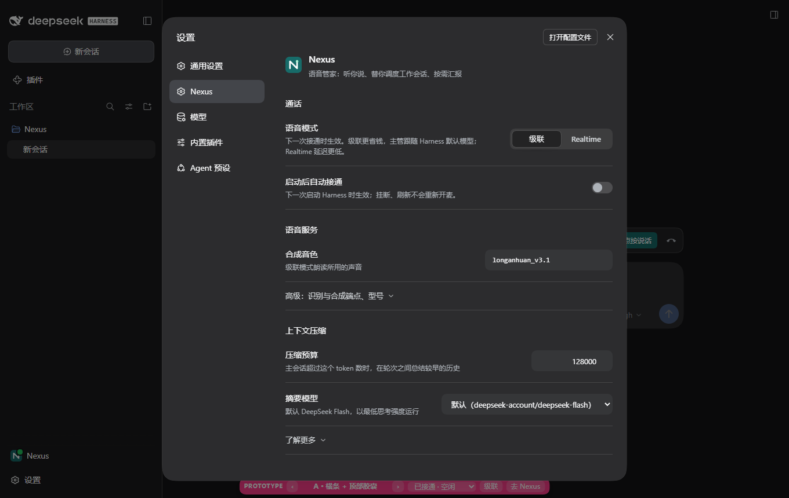
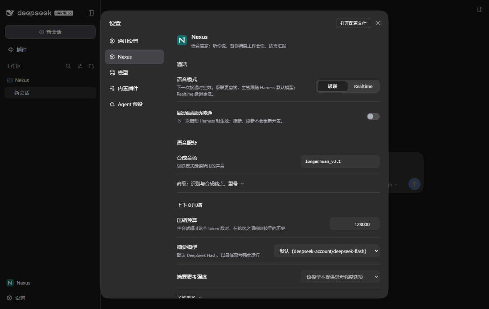
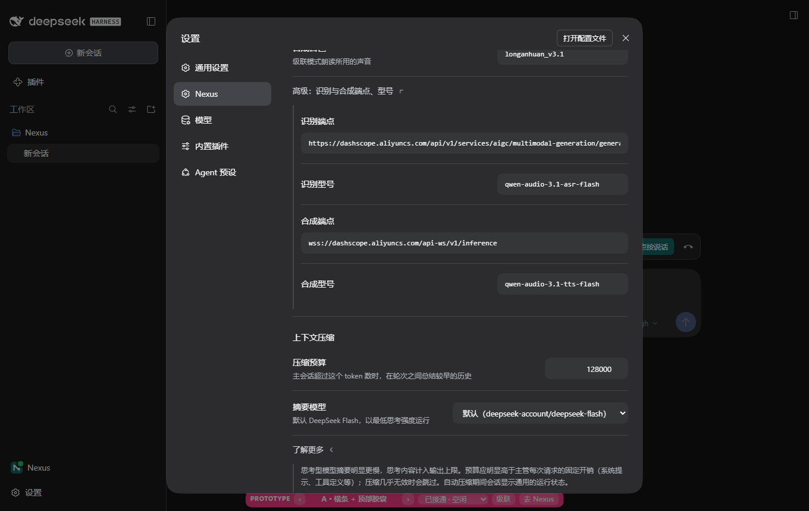
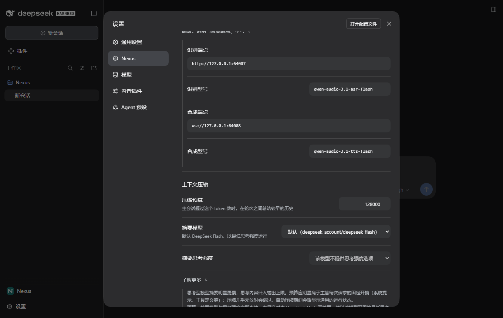
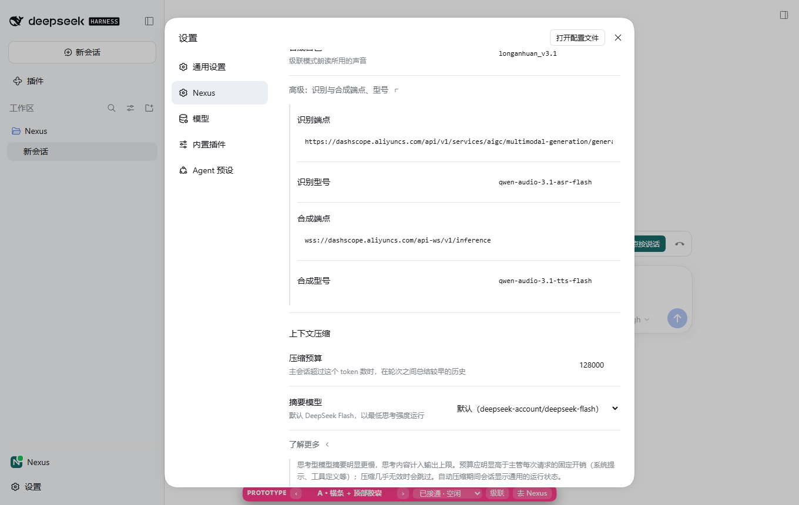
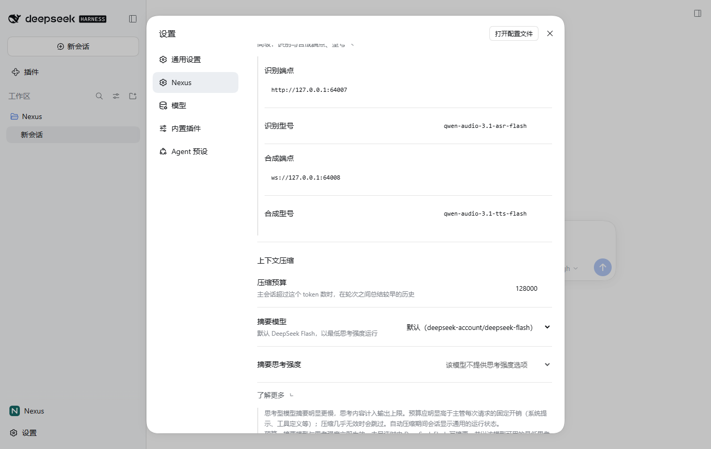
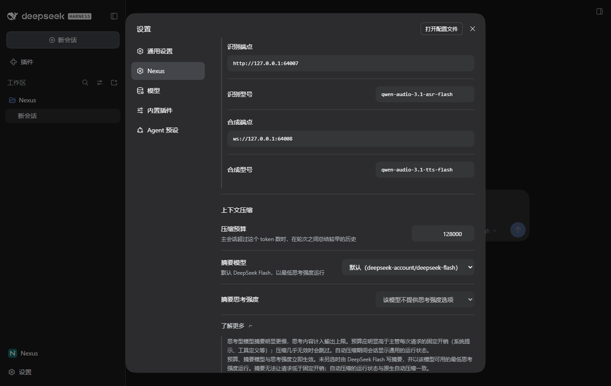
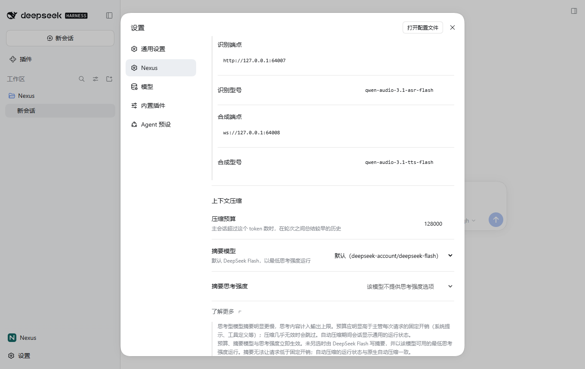

# 02：设置页原生行式布局验证

实施基点：`02f0e65`；原型蓝本：`506ba38`。本票实施及自验完成后交协调者安排独立评审，用户实机验收另行进行。

## 实施范围

- 移植原型 `Settings` 的结构、顺序、文案和图标，`Row`、`Disclosure` 及 `/* settings */` 样式段原样保留。复用票 01 的 primitives、Nexus 图标、品牌混色和样式注入。
- 三组为「通话」「语音服务」「上下文压缩」；语音模式使用 `SegmentedControl`，自动接通使用 `Switch`；端点和型号默认收在「高级」，音色常驻；「了解更多」默认折叠。
- 保留真实配置读取、写入失败提示、不可写和保存中禁用、预算校验及失焦 / Enter 提交。文本沿用去除首尾空白、空值不写入的语义，并按本票要求支持 Enter 提交。
- 原有默认摘要模型、已存但不在目录内的模型回显、思考强度选项计算全部保留。补回摘要思考强度行，为控件加与可见标题一致的无障碍名称。
- 中英文沿用 `ctx.locale.register`，删除由本次替换造成的无调用方旧设置文案。未修改配置项、键名、`src/`、协议、帧校验、`Call`、票 01 通话部件或侧栏。

## 受控环境与截图方法

原型由 `git worktree add .scratch/ui-polish/proto-506ba38 506ba38` 建立临时工作树；通过 junction 复用主工作树 `node_modules`，在临时工作树运行 `npm run build` 生成该提交自己的 `dist`。`.scratch/ui-polish/02-baseline.mjs` 通过既有 `startHost` 启动原型 `run.mjs`，沿用 `shots.mjs` 的设置操作，生成要求的四张原始 PNG。首次入口被宿主首次启动引导打断；补上受控测试已有的引导关闭步骤后成功。没有修改原型源代码或图片。

真实实现由 `tests/ui-polish.test.mjs` 新增设置用例驱动，复用票 01 的隔离官方 Harness Host、受控外部 LLM / ASR / TTS 夹具，执行真实客户端和配置表单。测试开始保持未接通，避免截图出现胶囊；没有注入假配置快照或替换界面。

两侧均使用 Edge / Playwright，`locale: zh-CN`、`viewport: 1360×860`、`deviceScaleFactor: 1`，分别使用 dark / light。设置场景按原型保存整个视口，不裁剪；展开场景都点击「高级」和「了解更多」，并对「上下文压缩」调用 `scrollIntoViewIfNeeded()`。新增行及完整说明增加页面高度，滚动位置因此不同，见偏离清单。真实截图切换主题后等待 250ms，使宿主主题过渡稳定。

要求的四张实现图以及两张完整说明补充图由 `$env:NEXUS_SETTINGS_SHOTS='1'` 显式存档；默认完整测试仅写 `.scratch/`，不会覆盖存档。最终截图现场：`.scratch/ui-polish/01-1792116331708`（沿用票 01 夹具目录前缀）。

临时工作树已经注销并清理：首次 `git worktree remove --force` 注销成功但 Windows 删除报 `Filename too long`；再次带 `core.longpaths` 时已不是工作树。随后使用 `.scratch/ui-polish/02-cleanup.mjs`，核实绝对路径只能是指定临时目录后，以 Node `fs.rmSync` 清理残留。主仓库 `node_modules` junction 已先单独解除，`git worktree list` 最终仅有主工作树。

## 基线与实现并排

| 场景 | 基线 `506ba38` | 真实实现 |
| --- | --- | --- |
| dark / settings |  |  |
| dark / settings-expanded |  |  |
| light / settings |  |  |
| light / settings-expanded |  |  |

补充截图滚动到说明末尾，以展示完整说明；原型没有此补充场景，不伪称存在对应基线。

| dark / 完整说明 | light / 完整说明 |
| --- | --- |
|  |  |

上述十张图片均已目视检查。共同区域保持原型布局；新增行与补充说明引起的高度和滚动差异如下。

## 偏离清单

1. **修复原型缺陷：补回摘要思考强度行。** 原型遗漏原有配置项。按 Spec 使用同一 `Row` 和 `.nx-set-select`，插在摘要模型后、「了解更多」前。默认模型在本环境未提供思考强度目录，显示原有禁用说明；选择提供强度的模型后恢复对应选项。新增行使折叠场景的「了解更多」移到视口下缘，展开场景滚动位置也相应变化；没有压缩间距、改变字号或隐藏配置来强行贴图。对照四组主图。
2. **修复原型缺陷：补齐原压缩说明。** 原型已有段落逐字保留，在同一 Disclosure 内追加同样 `.nx-set-note` 的第二段，补上立即生效、默认模型及最低强度、摘要无法低于固定开销、与原生运行状态一致等遗漏要点。由此产生的额外高度和底部裁切见 expanded 图，完整内容见 more 补充图；逐项对照如下。
3. **真实数据：端点、模型目录、通话状态和底层宿主画面。** 真实展开图端点为隔离 Host 使用的本地 HTTP / WebSocket 服务，原型为 DashScope 默认地址；摘要模型选项来自真实目录，原型省略了目录外值回显和强度行；真实未接通，侧栏没有绿色通话点，原型是假 ready，且设置后方仍留着模拟横条。票 01 的既有真实通话行为保持不变。对照四组主图。
4. **修复原型缺陷：表单可访问与真实保存反馈。** 原型 `Row` 内的文本 / 数字 / 下拉控件未与可见标题关联，补上相同标题的 `aria-label`，没有额外 DOM 或视觉样式。保存中临时禁用、失败时原有 alert、预算受控草稿及 Enter 提交沿用正式表单语义；文本 Enter 提交满足本票硬约束。中英文经现有 locale 读取，中文仍为原型原文。正常截图无失败 alert；对照四组主图和配置行为测试。
5. **原型专用元素按 Spec 不移植。** 原型底部粉色 `Switcher`、假 ready 状态和 localStorage 不进入正式客户端。对照四组主图底部及设置遮罩后的宿主画面。

除此之外未主动调整结构、DOM 顺序、类名、尺寸、间距、主题 token、文案或图标。截图时 chevron 过渡帧、主题过渡差异不作为静态样式更改；真实截图已等待主题稳定。源码核对确认 `Row` / `Disclosure` / settings CSS 与蓝本完全相同。

## 原压缩说明逐条对照

原文来源：`git show 02f0e65:client.js` 的中文 `compaction-hint`；两种语言都补齐相同语义。

| 原说明要点 | 新界面位置 / 对应内容 |
| --- | --- |
| 主会话超过预算，在轮次之间总结较早历史 | 「压缩预算」行说明，保留 token 预算及轮次间总结 |
| 预算、摘要模型与思考强度立即生效 | 「了解更多」第二段首句，三项完整列出 |
| 未另选时 DeepSeek Flash 写摘要 | 摘要模型行短说明 + 「了解更多」第二段 |
| 使用该模型可用的最低思考强度 | 摘要模型行短说明 + 第二段；原有强度选择逻辑保留 |
| 思考型模型摘要明显更慢 | 「了解更多」原型第一段首句 |
| 思考内容计入输出上限 | 同上，原型第一段首句后半句 |
| 预算应明显高于每次请求固定开销，含系统提示、工具定义等 | 第一段第二句，示例全部保留 |
| 摘要无法让请求低于固定开销 | 第二段第三句 |
| 压缩几乎无效时跳过自动压缩 | 第一段第二句末尾 |
| 自动压缩期间显示通用运行状态 | 第一段末句 |
| 与原生自动压缩一致 | 第二段末句 |

## 实际命令与结果

最终完整测试：149 项，137 通过、0 失败、12 跳过，退出码 0，耗时 1277.428 秒；三个 Desktop / 独立安装场景均实际通过。以下均为实际运行，不把原型截图当作正式 UI 测试。

| 命令 | 实际结果 |
| --- | --- |
| `git worktree add .scratch/ui-polish/proto-506ba38 506ba38` | 成功，detached HEAD `506ba38`，未改变主分支 |
| 临时工作树 `npm run build` | 通过，退出码 0；首次使用错误的相对日志目录，PowerShell 在启动构建前报目录不存在，改用主工作树绝对日志路径后成功 |
| `node .scratch/ui-polish/02-baseline.mjs` | 初次 0 图，30 秒超时定位 Nexus 设置按钮；补上首次启动引导关闭步骤后成功生成 4 图，退出码 0。日志 `02-baseline.log` / `02-baseline-retry.log` |
| `node --test --test-name-pattern='Nexus settings show' tests/ui-polish.test.mjs`（red） | 0 通过 / 1 失败，旧 UI 缺少「上下文压缩」分组，符合预期；`02-red.log` |
| 同一设置聚焦用例（初次移植后） | 0 通过 / 1 失败，测试误用 radio 角色，真实原生控件为 tab；修正测试角色后 1 通过 / 0 失败；`02-green.log` / `02-green-tabs.log` |
| `$env:NEXUS_SETTINGS_SHOTS='1'; node --test --test-name-pattern='Nexus settings show' tests/ui-polish.test.mjs` | 加完整说明断言和补充截图后 1 通过 / 0 失败（`02-settings-final.log`）；补上主题过渡等待后的最终存档轮 1 通过 / 0 失败，8.805 秒（`02-settings-shots.log`），生成 4 张要求图及 2 张补充图 |
| `node --test --test-name-pattern='Nexus conversation lists' tests/compaction.test.mjs` | 1 通过 / 0 失败，25.114 秒。含无强度禁用、Off 优先、显式模型默认、旧强度失效回落、0 / 小数预算不提交、Enter 保存、立即生效和重启持久化；`02-compaction.log` |
| `node --test --test-name-pattern='native Nexus settings\|persist the recognition\|several sentences\|startup voice: native' tests/cascade.test.mjs tests/cascade-tap.test.mjs tests/cascade-spoken.test.mjs tests/startup.test.mjs --test-concurrency=1` | Node 报 4 通过 / 0 失败，33.380 秒。其中 3 个匹配行为通过，spoken 文件没有匹配用例而作为空文件计 1；故不把此命令视为合成回归证据；`02-settings-existing.log` |
| `node --test --test-name-pattern='cascade speaks complete' tests/cascade-spoken.test.mjs` | 1 通过 / 0 失败，10.793 秒，合成型号和音色仍经真实 UI 保存并影响后续语音任务；`02-spoken.log` |
| `node --check client.js` | 最终通过，退出码 0；实施脚本初次拼接多出右括号，语法检查失败，修正后通过，未把错误版本当成功 |
| `npm run typecheck` | 通过，退出码 0 |
| `npm run build` | 通过，退出码 0 |
| `node .scratch/ui-polish/02-audit.mjs` | 最终通过，退出码 0。初次因分段比较多计一个换行失败，统一截段边界后通过。核对 Call / 帧校验、票 01 UI / CSS、默认模型、强度 / 预算 / 保存逻辑、slot wiring 不变；Row / Disclosure / settings CSS 等同原型；`02-audit.log` |
| `git diff --check` | 通过，无空白错误（Git 的 LF → CRLF 提示不是失败） |
| `$env:NEXUS_DESKTOP_SMOKE='1'; npm test` | 149 项：137 通过 / 0 失败 / 12 项真实服务 opt-in 跳过，退出码 0，1277.428 秒；日志 `.scratch/ui-polish/02-full.log`。包含新设置用例及票 01 UI 全部 7 个用例，三个 Desktop / 独立安装场景均实际通过 |
| `git worktree remove --force <绝对临时路径>`；`git -c core.longpaths=true worktree remove --force <同路径>`；`node .scratch/ui-polish/02-cleanup.mjs`；`git worktree list` | 前两次分别报路径太长和已不是工作树；核实绝对路径后脚本清理成功，最后仅主工作树。一次尝试 `node -e` 清理被 Windows 参数引号解析破坏，报 SyntaxError，没有执行删除；改用脚本后完成 |

本轮使用 Desktop 自带 CLI `D:/DeepSeekHarness/resources/runtime/cli/bin/dsh.cmd`。安装证据：级联 `.scratch/cascade-voice/06-installed-IfMshH`，干净 Realtime `.scratch/nexus-v1/ticket11-scenario-FMbN5X`，打包激活与恢复 `.scratch/nexus-v1/desktop-smoke-ZftAqw`。级联安装包 SHA256：`8a31e742f4440f64f25252b2686be593f4aa410d6ff46bccd325dfbf0ab227b2`。本轮 UI 现场为 `.scratch/ui-polish/01-1792117185792` 至 `01-1792117252966`，正式存档图片未被完整测试覆盖。

提交前另执行 `git diff --check`、`git diff --cached --check`，均通过，无空白错误。

## 边界与待验

- 协调者安排的标准轴、规格轴首轮评审均为 approve，无遗留问题。
- 用户实机目视验收尚未进行；真实麦克风、扬声器及真实 DashScope 服务未在本票另做验收。既有 opt-in 测试是否跳过以完整测试实际结果为准。
- 写入失败 alert、不可写禁用的原有代码保持不变，源码核对已通过；没有单独模拟配置文件写入失败或只读权限场景，因此不声称本票运行了这两项故障注入。
