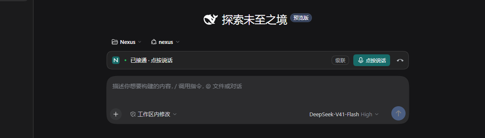
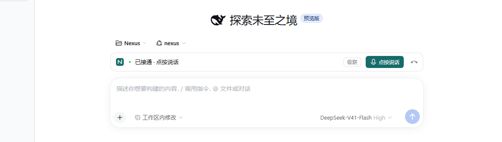
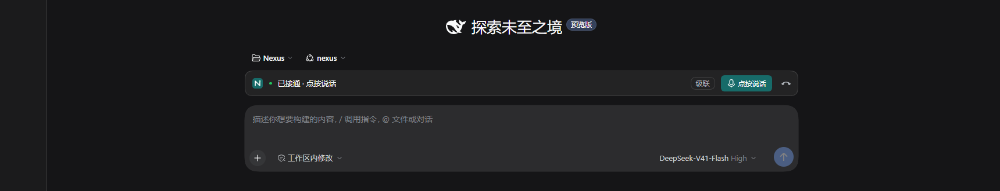
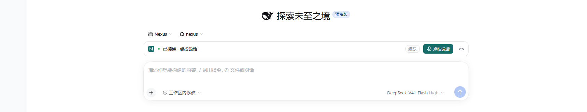
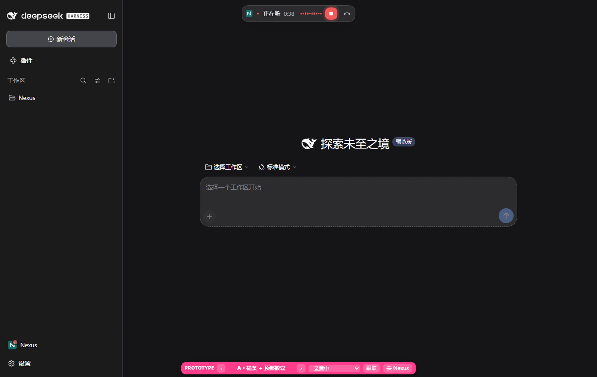
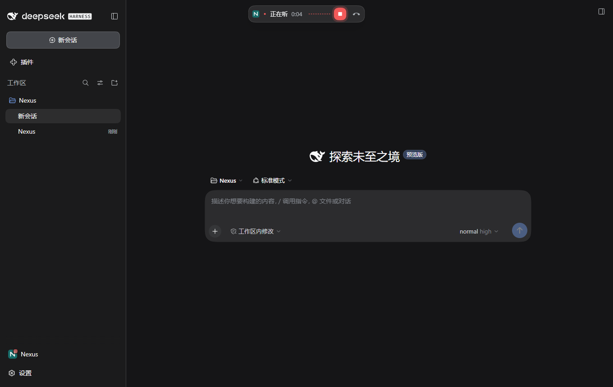
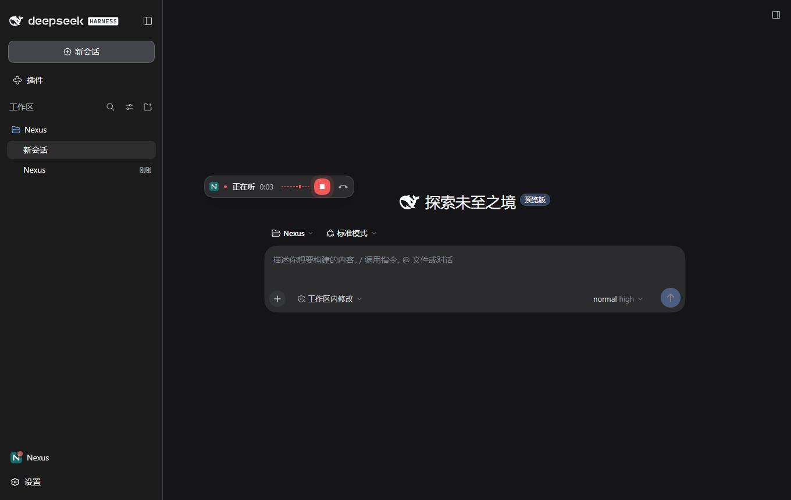
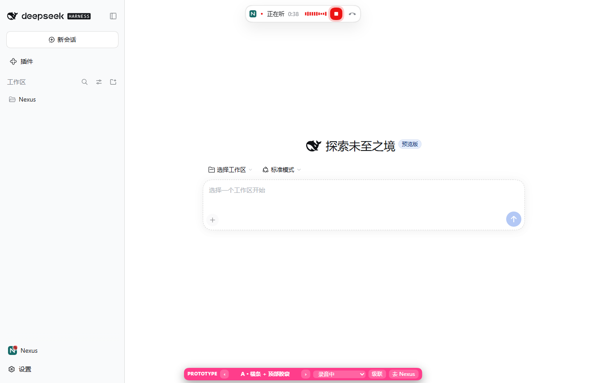
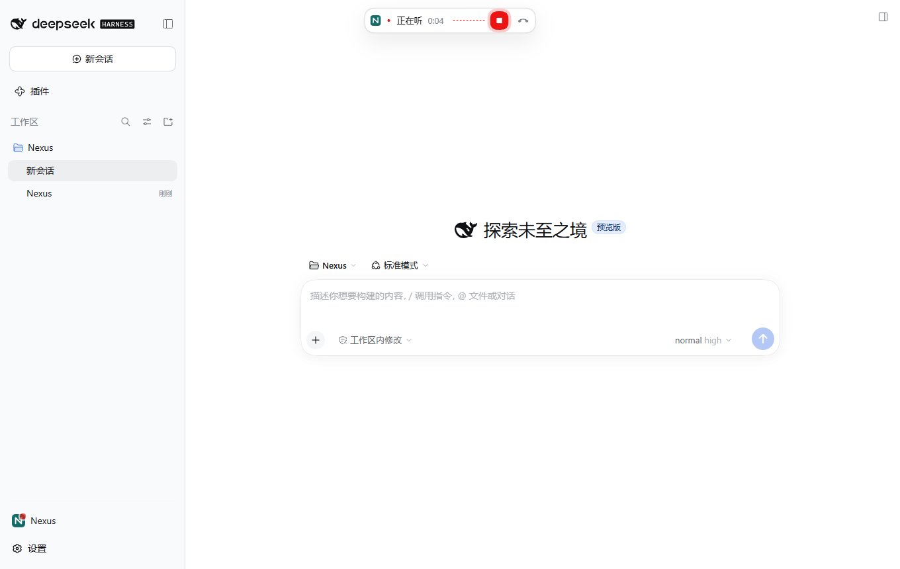
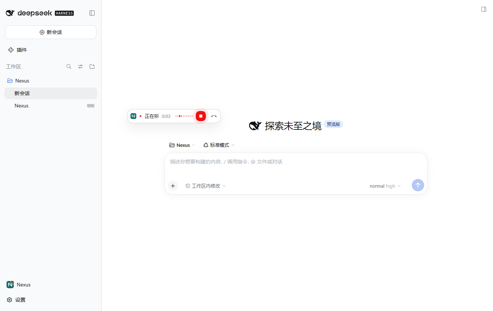

# 03：实机反馈——横条对齐、胶囊可点中与可拖动验证

实施基点：`ab3912c`。实施与自验由本票实施代理完成，独立 code-review 由协调者安排。本记录不代表评审或用户实机验收通过。

## 根因复核

- **横条比输入框窄。** 宿主 `.wSkVaW_body` 定义 `--dsh-chat-content-width: var(--dsh-chat-user-width, clamp(680px, 列宽 × .64, 920px))`、`--dsh-composer-card-max-width: calc(内容宽 + 32px)`、`--dsh-composer-side-clearance: 16px`；输入卡片 `.uV2eYG_card` 为 `width: 100%; max-width: var(--dsh-composer-card-max-width)`，外层 `.uV2eYG_root` 左右各留 `side-clearance`。`conversation.input.dock` 与输入框同为 `composerStack` 的直接子项。票 01 的 `.nx-a-bar` 写死 `max-width: 724px`，只在 1360×860 下恰好与卡片同宽；受控 Host 中 1920×1080 的卡片为 952px，用户拖宽后可到 1192px。与协调者结论一致。
- **胶囊点不中。** `@deepseek-ai/dsh-client-ui-layout` 在 `[data-windows-titlebar] .pI_x6G_frame:before` 上铺 `-webkit-app-region: drag`，高 `--dsh-windows-titlebar-height`；`shell.overlay` 层 `.pI_x6G_overlayLayer` 是覆盖整个 frame 的 `inset: 0` 层，胶囊 `top: 12px` 落在标题栏区域内，且未标记 `no-drag`（宿主自己的 `.pI_x6G_leadingSeat` 就标了 `no-drag`）。与协调者结论一致。修复前受控 Host 中横条及子元素的计算值均为 `none`（见下表红灯运行）。

## 实施范围

只改 `client.js` 渲染层与样式表：

- `.nx-a-bar` 的票 01 修正改为 `width: calc(100% - var(--dsh-composer-side-clearance) * 2); max-width: var(--dsh-composer-card-max-width); margin-inline: auto`，与输入卡片同一套宿主变量，不写像素。
- 新增 `.nx-a-bar, .nx-a-bar *, .nx-a-pill, .nx-a-pill * { -webkit-app-region: no-drag; }`；胶囊加 `user-select: none; touch-action: none`，拖动后加 `nx-a-pill-placed`（第 1 轮由 `nx-pill-placed` 改名）（`transform: none`）并以内联 `left` / `top` 定位。
- `PillA` 增加 `usePillDrag`：在胶囊空白处或图标状态区（`.nx-a-pill-main`）按下，移动 ≥ 4px 才算拖动；圆形录音、挂断、重试按钮上按下只按原样点击。拖动结束产生的那次点击在胶囊根节点捕获阶段吞掉，所以不会回到 Nexus，也不会录音或挂断。位置按 overlay 层（设置中则为模态层）`clientWidth/Height` 减胶囊尺寸夹紧；`ResizeObserver` 观察胶囊与所在层，窗口缩小或胶囊变宽时收回可见范围，窗口变大后回到保存的位置。松手时把夹紧后的位置写入 `localStorage['dsh-nexus.pillPosition']`，挂载时读取；读写都在 `try/catch` 里，失败或数据无效时不定位，即退回原型的顶部正中。
- 未改 `Call` 类、帧校验、设置页、`src/`、协议、状态码；原型 A 的 DOM 结构、类名、尺寸、文案、图标不变；仍最多一个 `[data-nexus-voice]`。

## 受控环境与截图方法

沿用票 01 的 `tests/ui-polish.test.mjs` 夹具：隔离的官方 Harness Host、真实 Nexus 客户端、受控 LLM / ASR / TTS，Playwright Edge 加假媒体设备，`locale: zh-CN`、`deviceScaleFactor: 1`。新测试 `call bar follows the host input width, both controls escape the Desktop drag region, and the pill drags and remembers its spot` 用真实操作驱动：

| 断言 | 做法 |
| --- | --- |
| 横条与输入卡片对齐 | 用 `getBoundingClientRect()` 比较横条与输入卡片（从 `contenteditable` 向上找到第一个圆角元素，与票 01 相同）的左右边缘，容差 ≤ 1px。空会话与有消息的会话各测 1360×860、1920×1080；再在 1920×1080 下拖动宿主真实的右侧宽度把手（`[data-width-handle=right]`）+120px，确认横条上能读到宿主设置的 `--dsh-chat-user-width`、卡片宽度确实变化后再测 |
| `no-drag` | 横条在接通前、接通后（此时含模式标签、「点按说话」、挂断）各断言一次，胶囊在录音中断言一次：根节点及全部子元素的 `getComputedStyle(...).getPropertyValue('-webkit-app-region')` 均为 `no-drag`。同时断言胶囊的 `offsetParent` 在 overlay 层是 `[data-shell-overlay]`，在设置模态层中不为 null |
| 拖动 | 录音中进入另一个会话；Playwright 鼠标从状态区拖 (-300, +240)、再从空白处拖 (+100, +50)，位置误差 ≤ 1px；横条未出现，`data-state` / `data-activity` 仍为 `live` / `recording`。随后点胶囊里的「结束录音」，胶囊原地不动、录音照常结束 |
| 夹紧与收回 | 拖向 (+2000, +2000)，胶囊停在 1360×860 右下角；视口缩为 900×600 后收回到新右下角；恢复 1360×860 后回到保存的位置 |
| 短点按与恢复 | 只移动 2px 的点按回到 Nexus；再进入其他会话，位置恢复；`page.reload()` 后重新接通、进入其他会话，位置恢复 |
| 存储不可用 | 把 `Storage.prototype.getItem/setItem` 对 `dsh-nexus*` 键改为抛 `SecurityError`，重新进入其他会话：胶囊回到顶部正中，仍可拖动。测试结束时断言整个用例（包括重载之后）都没有 `pageerror` 或 console error，只过滤一条已知的宿主报错，见「边界与待验」 |
| 单控件 | 页面级 `MutationObserver` 未见过多于一个 `[data-nexus-voice]` |

截图：横条在接通后空会话（即基线 `ready` 状态）下截取，1360×860 沿用票 01 的裁剪 `{ x: 200, y: 卡片 y - 190, width: 1160, height: 330 }`，1920×1080 用同样规则 `width: 视口宽 - 200 = 1720`；胶囊为拖动后、录音计时到 0:03 以后的整张视口。截图只在 `NEXUS_UI_SHOTS=1` 下写入本目录，此前已删除测试中途写入的用户聊天宽度，避免其他会话的输入框也被拉宽。

受控 Host 中最后一次截图运行的测量（`.scratch/ui-polish/01-1792153994729/03-measurements.json`）：

| 场景 | 横条 x / 宽 | 输入卡片 x / 宽 |
| --- | --- | --- |
| 空会话 1360×860 | 454.906 / 723.188 | 454.906 / 723.188 |
| 空会话 1920×1080 | 620.5 / 952 | 620.5 / 952 |
| 有消息 1360×860 | 454.906 / 723.188 | 454.906 / 723.188 |
| 有消息 1920×1080 | 620.5 / 952 | 620.5 / 952 |
| 用户拖宽后 1920×1080 | 500.5 / 1192 | 500.5 / 1192 |

## 基线与实现并排

| 场景 | 基线 `506ba38` | 票 01 实现 | 本票实现 |
| --- | --- | --- | --- |
| dark / 横条 1360×860 |  |  |  |
| light / 横条 1360×860 |  |  |  |
| dark / 横条 1920×1080 | 无（基线只有 1360×860） | 无 |  |
| light / 横条 1920×1080 | 无（基线只有 1360×860） | 无 |  |
| dark / 拖动后的胶囊 |  |  |  |
| light / 拖动后的胶囊 |  |  |  |

像素核对（`sharp` 逐像素比较 RGB）：

- `dark-bar-align-1360.png` 与票 01 `dark-bar-ready.png` 完全相同（0 个像素不同）；与基线的差异只有 1628 个像素，全部位于 y 200–212、x 269–578 的输入框占位文字行，与票 01 对基线的差异完全相同（同为 1628 像素、同一范围），不是本票引入的。
- `light-bar-align-1360.png` 与票 01 `light-bar-ready.png` 有 270 个像素不同，最大通道差 1/255，散布在输入卡片的柔和阴影边缘，属于渲染噪声；与基线的其余差异同样是占位文字行（票 01 对基线为 1625 像素、同一范围）。
- 1360×860 下横条宽度为 723.188px，票 01 截图中的横条也是这个宽度（`calc(100% - 32px)` 本来就小于 724px 上限），所以本视口下视觉不变。

## 偏离清单

1. **横条宽度跟随宿主输入框变量（本票要求）。** 原型和票 01 用 724px 上限，本票改为与输入卡片同一组 `--dsh-composer-*` 变量。1360×860 下与票 01、基线视觉一致（见上面的像素核对）；1920×1080 及用户自定义宽度下横条随卡片变宽到 952px、1192px，基线没有对应视口。对照两张 1920 截图与测量表。
2. **胶囊位置可拖动（本票要求）。** 默认仍在顶部正中（存储不可用时的断言）；拖动后离开顶部正中，图中胶囊在 (351, 302) 附近。胶囊自身的结构、尺寸、配色、图标与票 01 一致；计时 `0:03`、波形高度与基线 `0:38` 不同属于票 01 已登记的真实数据差异。对照两张 pill-dragged 截图。
3. **继承自票 01、非本票引入的差异。** 截图中的宿主界面（已选择的 Nexus 工作区、会话树、占位文字、模型名）及基线里原型专用的粉色 `Switcher`，均按票 01 偏离清单第 2、7 条处理，本票未改变。
4. **拖动后的胶囊坐标用内联样式。** Spec「技术路线」要求样式统一进注入样式表、不再写内联样式；拖动位置是逐帧变化的运行时坐标，无法预先写成类，所以只把 `left` / `top` 两个像素值写在内联 `style` 上，`transform: none` 等其余样式仍在样式表的 `.nx-a-pill.nx-a-pill-placed` 里。这与原型及票 01 已有的 `Bars` 用内联 `transform: scaleY(…)` 表达实时电平是同一类处理。对照两张 pill-dragged 截图。

新增的 `user-select: none`、`touch-action: none` 和 `-webkit-app-region: no-drag` 不改变渲染像素（1360 横条截图与票 01 相同可作佐证）。

## 实际命令与结果

| 命令 | 实际结果 |
| --- | --- |
| `node --test --test-name-pattern='follows the host input width' tests/ui-polish.test.mjs`（实现前，红灯） | 前两次 0 通过 / 1 失败：`waiting for Host URL`，Host 日志为空（票 01 也遇到过同一启动超时）；第三次 Host 正常启动，0 / 1，失败于 `.nx-a-bar opts out of the drag region: none,none,…`。日志 `.scratch/ui-polish/03-red.log` |
| 同上（实现后首次） | 0 / 1：重载后宿主报 `Error: sessions.retain: unknown session nexus-supervisor`，命中当时放在测试末尾的「无页面错误」断言；把断言移到重载之前（覆盖存储不可用的全部步骤）并同时收集 console error |
| 同上（调整后） | 1 通过 / 0 失败。日志 `.scratch/ui-polish/03-green.log` |
| `node --test tests/ui-polish.test.mjs` | 8 通过 / 0 失败，退出码 0，耗时 99.9 秒；票 01 的 1360×860 对齐断言、单控件断言、胶囊回到 Nexus 等原有用例全部通过。日志 `.scratch/ui-polish/03-ui-file.log` |
| `NEXUS_UI_SHOTS=1 node --test --test-name-pattern='follows the host input width' tests/ui-polish.test.mjs` | 1 通过 / 0 失败，生成上面 6 张新截图；没有运行其他会覆盖票 01 截图的用例。最后一次运行现场 `.scratch/ui-polish/01-1792153994729` |
| `node --check client.js` | 通过，退出码 0 |
| `npm run typecheck` | 通过，退出码 0 |
| `npm run build` | 通过，退出码 0，`dist/` 无变化 |
| `git diff --check` | 通过 |
| `NEXUS_DESKTOP_SMOKE=1 npm test` | 150 项：138 通过 / 0 失败 / 12 跳过（均为需要显式启用真实 DashScope / Realtime 的 opt-in 用例），退出码 0，耗时 1297 秒。Desktop 级联安装、干净 bundled profile、Desktop CLI 激活与恢复三个场景均实际执行通过，新用例 1 / 0。日志 `.scratch/ui-polish/03-full.log`；安装证据 `.scratch/cascade-voice/06-installed-a5wq36`、`.scratch/nexus-v1/ticket11-scenario-tmunY5`、`.scratch/nexus-v1/desktop-smoke-wJf56t`；级联安装包 SHA256 `2d6ee86f2bb02072ca0f36e7222a50c37f13261488538a63ba4aace2a21f517e` |
| 完整套件之后，临时把 `.nx-a-bar` 恢复为票 01 的 `calc(100% - 32px)` / `max-width: 724px` 再跑新用例（红灯复核） | 0 / 1，失败于 `empty 1920x1080: bar {"x":734.5,…,"width":724} aligns with input card {"x":620.5,"width":952}`，证明新断言能抓住原缺陷；随即用备份恢复 `client.js` 并以 `cmp` 确认与提交内容一致。日志 `.scratch/ui-polish/03-red-width.log` |

实施中曾启动过一次完整套件，开始约一分钟后主动停止（随后又改了拖动结束后的点击标记复位，避免官方开发 Host 在运行中热重载客户端），没有使用该轮结果；改完后重新运行了 `node --check`、typecheck、build 和新用例截图，再启动上表这轮完整套件，运行期间未改动客户端。

## 边界与待验

- **Electron 拖动区只能实机确认。** Playwright 不实现 `-webkit-app-region`，测试只能断言计算样式为 `no-drag`；胶囊在 Windows Desktop 标题栏上能否点中、能否拖动而不是拖窗口，需要用户在 Desktop 实机确认。
- **Desktop 实机的对齐。** 受控 Host（Web）中三种宽度已按像素断言；Desktop 默认窗口下的横条与输入框对齐也需用户实机看一眼。
- **重载后的宿主错误（既有宿主问题，与本票无关）。** 新用例在 `page.reload()` 之后稳定观察到 `Error: sessions.retain: unknown session nexus-supervisor`。抛出点是 `@deepseek-ai/dsh-api-session-controller/lib/client.js` 的 `resolveTarget`：会话目录（`sessions` / `summaries`）还没加载完时，用字符串 id 获取会话就直接抛错。重载后，测试在侧栏点「打开 Nexus」，或启动认领触发 `openSession(SUPERVISOR)`，都可能早于目录到达。`git diff ab3912c adba7d9 -- client.js` 中没有任何 `openSession` 改动，三处 `openSession(SUPERVISOR)` 调用在 `ab3912c` 上完全相同。规格评审的只读分析结论相同。第 1 轮起，测试在重载之后照样断言没有页面或 console 错误，只过滤这一条完全相同的宿主报错；最近一次运行记录的 `pageErrors` 只有这一条（`.scratch/ui-polish/01-1792156092290/03-measurements.json`）。
- **嵌入式会话（已知边界，不处理）。** 宿主 `.wSkVaW_embeddedBody` 把卡片上限写成 `min(calc(100% - 16px), 952px)`。`100%` 在卡片处按 `.uV2eYG_root` 内容框解析，在横条处按 `composerStack` 解析，两者相差两侧各 8px 的 clearance，所以在该变体里横条可能比卡片宽约 16px。不处理的原因：横条只在 Nexus 主会话（`sessionId === SUPERVISOR`）的 `conversation.input.dock` 中渲染，主会话走 `.wSkVaW_body` 而不是嵌入式变体；为这个用不到的变体再加覆盖规则，属于为假设场景写代码。因此本票未处理，也未测试。
- **胶囊可以拖到标题栏或窗口按钮附近（待实机观察）。** 夹紧范围是整个 overlay 层，其中包含 Windows 标题栏和右上角的窗口控制按钮区域，Spec 也只要求「限制在窗口可见范围内」。胶囊自身 `no-drag`，所以它所在的位置不会被当成拖窗口；但它可能盖住标题栏的拖动区或窗口按钮，这种情况是否可以接受，请用户在 Desktop 实机观察。
- 未调用真实 DashScope 服务；假媒体不代表真实麦克风体验。

## 第 1 轮评审修复

基点仍为 `ab3912c`，修复前 HEAD 为 `adba7d9`。

- **S1 — fixed。** 状态类 `nx-pill-placed` 改为「块名-修饰」写法 `nx-a-pill-placed`，`PillA` 与样式表 `.nx-a-pill.nx-a-pill-placed` 同步修改。
- **S2 — fixed。** 胶囊是 `position: absolute` 且已挂载在文档中，按 CSSOM View 规范，此时 `offsetParent` 只在元素或祖先 `display: none`、元素为 `position: fixed` 或未连接到文档时才为 null，这些情况在 overlay 层和设置模态层中都不会出现。测试分别在 overlay 层（`offsetParent` 带 `data-shell-overlay`）和设置模态层（不为 null）断言了这一点。据此删去 layout effect 中的 `if (ref.current.offsetParent)` 和 `fit` 中的 `!layer`，使其与 `onPointerDown` 的写法一致。`fit` 保留对 `ref.current` 为 null 的判断：拖动途中胶囊卸载（例如通话在拖动时结束）后 React 会把 ref 置空，而全局的 `pointermove` / `pointerup` 监听仍会调用 `fit`。
- **S3 — fixed。** fixture 把已有的 `pageErrors`（同时收集 `pageerror` 与 console error）传给用例，新用例删去自己重复注册的监听；深浅主题截图循环合并为 `shoot(name, clip)`，横条与胶囊截图共用。
- **P3 — fixed。** 接通后再断言一次横条 `no-drag`，并确认此时横条里确实有「点按说话」、挂断和模式标签，这些子元素都被断言覆盖。
- **P4 — fixed。** 内联 `left` / `top` 登记为偏离清单第 4 条。
- **P5 — fixed。** 「无页面错误」断言移到用例末尾（重载之后），只过滤一条完全相同的 `Error: sessions.retain: unknown session nexus-supervisor`。该报错登记为既有宿主问题、与本票无关，证据见「边界与待验」。本轮运行中这条报错确实出现并被过滤，其余错误为空。
- **P1 — 不处置。** 「边界与待验」写明了相差 16px 的成因，以及不处理的原因。
- **P2 — 不处置。** 「边界与待验」新增一条待实机观察项：胶囊可能被拖进标题栏或窗口按钮附近。

本轮重新生成截图（`NEXUS_UI_SHOTS=1`）后与已提交版本逐像素比较：`light-bar-align-1360.png` 只有最大 1/255 的阴影噪声；两张 pill-dragged 的差异全部位于实时波形与录音按钮脉冲动画（x 480–600、y 300–340）。改名和测试调整都不改变渲染，所以保留已提交的截图，没有替换。

| 本轮命令 | 实际结果 |
| --- | --- |
| `node --check client.js` | 通过 |
| `npm run typecheck` | 通过 |
| `node --test tests/ui-polish.test.mjs` | 8 通过 / 0 失败，退出码 0，耗时 97.4 秒。日志 `.scratch/ui-polish/03-r1-ui.log` |
| `NEXUS_UI_SHOTS=1 node --test --test-name-pattern='follows the host input width' tests/ui-polish.test.mjs` | 1 通过 / 0 失败；测量与上表相同，`pageErrors` 只有那一条已知宿主报错。现场 `.scratch/ui-polish/01-1792156092290`，生成的截图未采用（见上） |
| `NEXUS_DESKTOP_SMOKE=1 node --test --test-concurrency=1 tests/desktop.test.mjs tests/cascade-install.test.mjs tests/clean-install.test.mjs` | 3 通过 / 0 失败 / 0 跳过，退出码 0，耗时 55.6 秒。证据 `.scratch/cascade-voice/06-installed-1go4Mt`、`.scratch/nexus-v1/ticket11-scenario-hbikZt`、`.scratch/nexus-v1/desktop-smoke-DAdXAb`；级联安装包 SHA256 `dc3926683a7ab599d74fa404273856e6528fafa1528026187ff955a744766393` |
| `git diff --check` | 通过 |

按协调者安排，本轮没有重跑完整套件。
